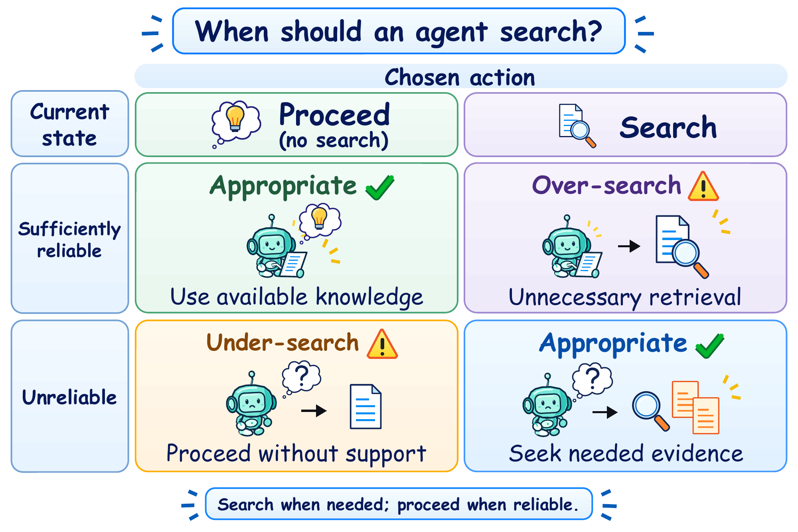
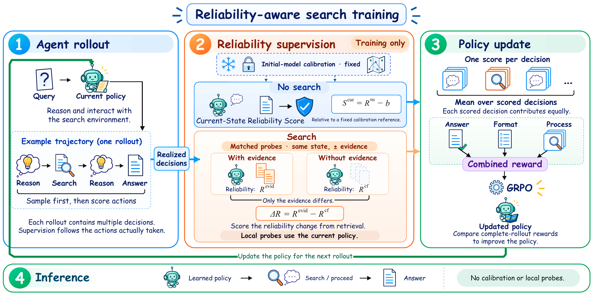

# ReliSearch

**Search When Needed, Proceed When Reliable: Metacognitive Reliability Monitoring for Efficient Agentic Search**

> **Code coming soon.** We are organizing the code and will release it in this repository.

## Overview

ReliSearch is a metacognitive framework for training language models to **search when external evidence is needed and proceed when their current information is sufficiently reliable**.

Final-answer correctness alone does not tell us whether a search decision was appropriate: a correct answer may come from a lucky guess, while a successful reasoning trajectory may contain unnecessary searches. ReliSearch addresses this performance-reliability mismatch by supervising the reliability of intermediate conclusions.

  

*Motivation: under-search proceeds from an unreliable state; over-search retrieves despite sufficient reliability.*

## Framework

  

During training, ReliSearch samples local conclusions from the current policy and converts their mean sequence uncertainty into reliability estimates using a fixed empirical mapping for each backbone. Two complementary scores supervise search decisions:

- **Current-State Reliability Score:** evaluates no-search decisions by comparing reliability under the current information with a fixed calibration reference.
- **Search-Action Reliability Score:** evaluates search decisions by measuring the reliability change between matched contexts with and without the retrieved evidence.

The mean action score forms a process reward, which is combined with answer and format rewards for **Group Relative Policy Optimization (GRPO)**. At inference, the learned policy directly generates reasoning, search requests, and final answers, without calibration or local probing.

## Results at a Glance

- **Answer quality:** the Qwen2.5-7B model achieves **69.3 weighted-average Cover Exact Match (CEM)** across seven QA benchmarks, exceeding HiPRAG by **2.1 points**.
- **Search allocation:** in a separate controlled 3B evaluation, ReliSearch uses **7.4% fewer searches overall** than our HiPRAG reimplementation, with fewer searches on single-hop tasks and more on multi-hop tasks in aggregate.
